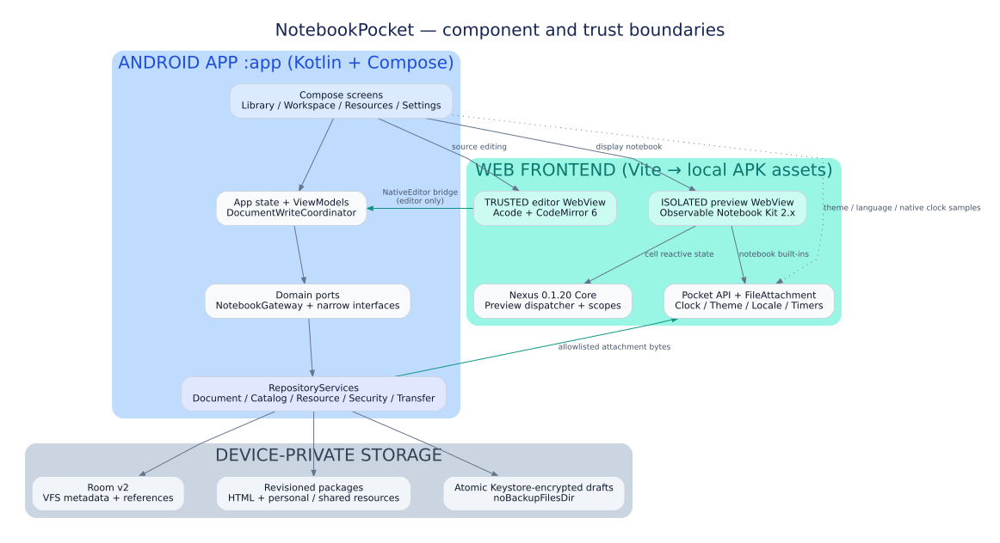
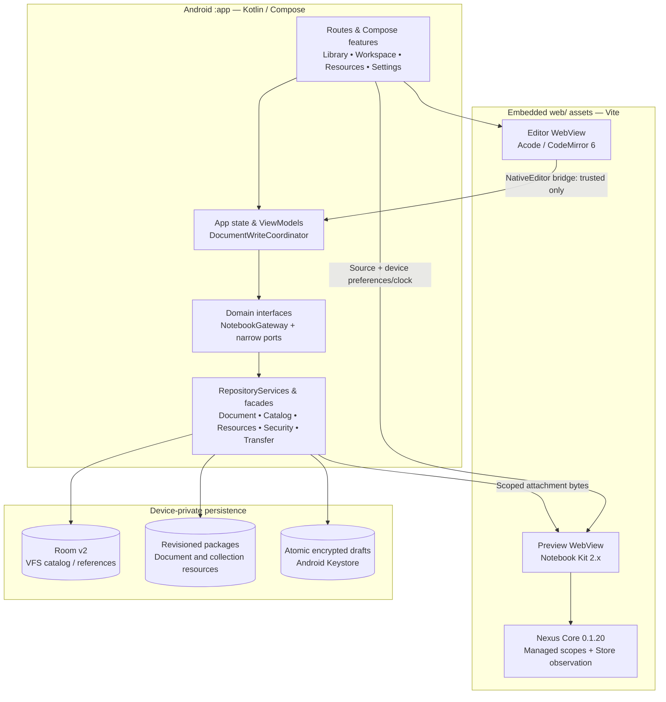
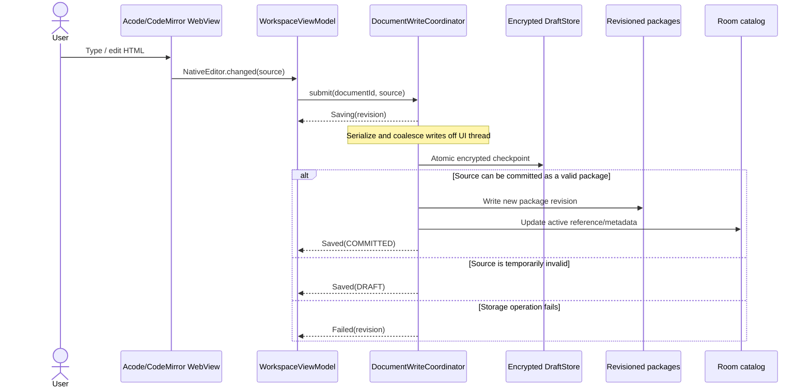
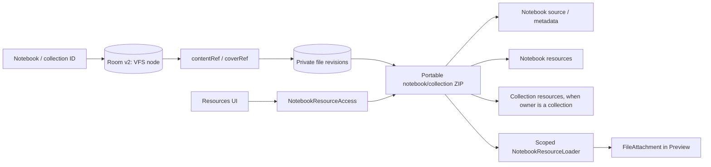
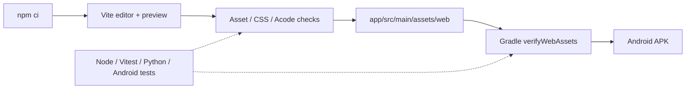

# NotebookPocket architecture

> **Implementation reference for NotebookPocket 0.9.3.** Android uses one Gradle module, `:app`, organized into logical packages. The embedded JavaScript frontend is a separate **Vite/npm project** in `web/`, not a second Android Gradle module.

NotebookPocket is a local-first Android editor and runtime for **Observable Notebooks 2.0**. The native UI is Kotlin/Jetpack Compose; the source editor adapts **Acode + CodeMirror 6**; executable notebooks use **Observable Notebook Kit 2.x** with **[Nexus Core 0.1.20](https://github.com/KarandaevRuslan/Nexus)** as an optional transactional/reactive state layer.

## 1. Architecture diagram



[Open the full-size SVG](docs/architecture/system-overview.svg) · [Edit the Graphviz source](docs/architecture/system-overview.dot)

The same boundaries as a GitHub-rendered Mermaid graph:



**Trust boundary:** the editor receives the native `NativeEditor` bridge; the preview **does not**. The preview runs notebook JavaScript on its own per-document origin, with a scoped local resource loader and blocked external requests. It is **not** a full security sandbox: notebook JavaScript can still consume CPU/memory and control its own DOM.

## 2. Repository / module map

```text
NotebookPocket/
├── app/                     Only Android Gradle module (:app)
│   └── src/main/java/dev/pocket/notebook/
│       ├── app/             App composition, route and adaptive layout
│       ├── core/            State coordination, logging, common UI
│       ├── domain/          Public repository interfaces / contracts
│       ├── data/            Persistence & use-case implementations
│       ├── feature/         Library, workspace, resources, settings
│       ├── web/             Android WebView hosts and safe asset loader
│       ├── settings/        Persisted app/editor preferences
│       ├── i18n/            Android localization helpers
│       └── ui/theme/        Compose theme
├── web/                     npm/Vite frontend, bundled into the APK
│   ├── src/editor/          Host-side editor integration
│   ├── src/acode/           Adapted upstream Acode components
│   ├── src/preview/         Notebook Kit & Nexus lifecycle
│   ├── src/pocket-context.js
│   ├── src/attachment-resolver.js
│   ├── vendor/             Pinned local Nexus npm package
│   ├── tests/              Node / Vitest / integration checks
│   └── scripts/            Build, provenance and asset verification
├── examples/                Importable sample notebooks
├── third_party/             Attribution, vendored-source provenance
├── docs/                    API, architecture, building and release docs
├── scripts/                 Repository / release verification helpers
├── tests/                   Python repository/contract checks
└── .github/workflows/       CI, emulator checks and APK releases
```

### Android logical modules / packages

| Package | Responsibility | Main entry points |
| --- | --- | --- |
| `app/` | Root composables, startup, navigation, orientation/adaptive layouts and process-owned repository bootstrap. | `NotebookPocketApp`, `RepositoryBootstrap`, navigation routes |
| `feature/library/` | Catalog UI, folders, cover cards, sorting/reordering, metadata and protection dialogs. | `NotebookLibraryScreen`, `LibraryViewModel` |
| `feature/workspace/` | Code / Preview / Resources workspace, document state, save status and retry. | `NotebookDetailScreen`, `WorkspaceViewModel` |
| `feature/files/` | Notebook and shared-collection Resources tab, tree navigation, import/export actions, text/image viewers. | `ResourceManager`, `ResourceTextEditor`, `ResourceScopeSelector`, `PocketTools` |
| `feature/settings/` | Preferences UI and editor options. | Settings composables |
| `core/state/` | Application-level library snapshot and **serialized asynchronous writes**; handles queued writes, flushes and deletion coordination. | `NotebookAppState`, `DocumentWriteCoordinator`, `RepositoryWriteScopes` |
| `core/logging/`, `core/ui/` | Diagnostic logging and reused UI primitives. | `NotebookLog`, common UI components |
| `domain/` | Kotlin interface contracts that UI/services depend on. | `NotebookGateway`, `NotebookDocuments`, `NotebookResourceAccess`, `NotebookSecurity`, `NotebookTransfer` |
| `data/facade/` | Implements domain ports, forwards through a serialized repository executor. | `DocumentFacade`, `CatalogFacade`, `ResourceFacade`, `SecurityFacade`, `TransferFacade` |
| `data/document/` | Load/create/edit source and package content; resolves valid package vs recoverable draft. | `DocumentEditor`, `DocumentContent` |
| `data/catalog/` + `data/collection/` | Virtual catalog/folders, collection membership and shared resource representation. | `LibraryCatalog`, `LibraryOperations`, `CollectionStore`, `CollectionConversion` |
| `data/resource/` | Resource tree, notebook/collection ownership, safe replacement, attachment allowlists. | `NotebookResources`, `ResourceAccess` |
| `data/local/` | Room v2 VFS metadata, DAO and underlying private file-store implementation. | `NotebookDatabase`, `VfsDao`, `DocumentFileStore` |
| `data/storage/` + `data/draft/` | Revisions, incomplete-write recovery, atomic encrypted checkpoints. | `Revision`, `StorageRecovery`, `DraftStore`, `KeystoreDraftCipher` |
| `data/security/` | Password protection, key cache and encryption policy. | `NotebookCrypto`, `DocumentSecurity`, `DeviceKeyCache` |
| `data/packing/` + `data/transfer/` | Notebook/collection ZIP representation, bounded archive handling, import/export. | `NotebookPackage`, `ArchiveFiles`, `DocumentImporter`, `LibraryTransfer` |
| `data/demo/` | Seed and safe migration of bundled sample content. | `PancakeDemo`, `DemoUpgrade` |
| `web/` (Kotlin package) | Creates editor/preview WebViews, manages origins, bridges, IME, local assets and attachment HTTP interception. | `NotebookEditorWebView`, `NotebookPreviewWebView`, `EditorBridge`, `NotebookResourceLoader` |
| `settings/`, `i18n/`, `ui/theme/` | Language/theme/editor preferences, translated Android strings and visual theme. | `AppPreferences`, `EditorPreferences`, `NotebookTheme` |

`NotebookRepository` is a **single public facade** that implements `NotebookGateway` by delegating to specialized facades. `RepositoryServices` constructs the implementation graph. The process-owned repository prevents Activity recreation from unnecessarily discarding session state.

### Embedded web logical modules

| Location | Purpose |
| --- | --- |
| `web/src/editor.js`, `web/src/editor/` | Editor bootstrap, document lifecycle, CodeMirror events, commands, search and Android editor protocol. |
| `web/src/acode/vendor/`, `web/src/acode/host/` | Preserved/ported Acode editor functionality plus NotebookPocket-specific host integration. |
| `web/src/preview.js`, `web/src/preview/application.js` | Preview boot, source rerender, theme/language updates, state reset, form restoration and teardown. |
| `web/src/preview/notebookRuntime.js` | Observable Notebook Kit `deserialize`/`transpile`, cell execution and host built-ins. |
| `web/src/preview/nexusRuntime.js` | Creates one Nexus dispatcher per preview and exposes `Nexus` and `nexus`. |
| `web/src/pocket-context.js` | Builds read-only `Pocket` app context, native-sampled clock and document timers. |
| `web/src/attachment-resolver.js` | Converts allowlisted resource names to scoped per-document URLs; does not expose filesystem paths. |
| `web/src/preview/formState.js`, `web/src/preview-state.js` | Public form persistence, state-version keys, reset and bounded legacy migration. |
| `web/src/observable-offline-library.js`, `web/src/preview/inputs-theme.css` | Bundled offline `Inputs`/`htl` and shared styling applied to **all** notebooks. |
| `web/scripts/`, `web/tests/` | Build consistency/provenance checks, Acode regressions, Notebook Kit/Nexus integration tests. |

## 3. Source editing and saving



A durable **draft checkpoint** is independent of the portable document package. The draft can preserve temporarily invalid HTML, while the last valid package remains available. The draft is encrypted with Android Keystore under the app's `noBackupFilesDir`. User password protection of portable packages is a **different** encryption mechanism.

`DocumentWriteCoordinator` coalesces changes (nominal 200 ms), serializes storage operations and coordinates destructive mutations so a pending edit cannot recreate a deleted document. An acknowledgement is produced after persistence work, not on receipt of a keystroke. The app still needs device-level testing for process death during the tiny debounce window; not every typed character is instantly durable.

Room and the filesystem do not form a single physical transaction. The revision workflow changes references after creating new files and the startup recovery process cleans safe orphan/temp files; it does not imply fully atomic cross-store commits.

## 4. Data layout and resource ownership



Resources are attached to the **notebook itself** or **shared with notebooks belonging to a collection**. The preview gets only registered names and can request `FileAttachment('path')` or `FileAttachment('shared/path')`. It cannot browse arbitrary Room tables or host paths. The native resource API supports browsing, CRUD, rename, transfer and a hash-checked replace operation; see [API reference](docs/API.md#4-notebook-and-collection-attachments-fileattachment).

ZIP repacking is still a cost for very large documents or collections. The existing portable format was preserved to maintain compatibility; it is **not** a content-addressed incremental storage system.

## 5. Trust, execution and public APIs

**Android editor (trusted):** source, viewport, search state and clipboard move through `NativeEditor`/`EditorBridge` (installed only on the editor WebView). The editor is not a general document execution host.

**Notebook preview (less trusted):** `NotebookPreviewWebView` derives a stable per-document preview host, enables DOM storage only for unprotected content, and serves bundled HTML/JS/CSS locally. `NotebookResourceLoader` requires the expected host and session-specific resource scope. Android's WebView client denies external requests. Notebook JavaScript is evaluated in the preview, with **no native JavaScript bridge**.

**Notebook-visible APIs:**

- `Pocket` — resolved theme, language/locale, time zone, 12/24-hour mode, device-sampled clock and named timers; `pocketNow` is a reactive Date updated about once per second.
- `FileAttachment` — Notebook Kit attachment API backed by personal/collection resource allowlists and local bytes.
- `Nexus` — the bundled upstream Nexus Core API. `nexus` — NotebookPocket's preview-scoped dispatcher/scope/Observable bridge.
- Standard Notebook Kit cells and packaged `Inputs`, `htl`, `html`, `svg` built-ins.

For the **exact API signatures, examples and the way Android supplies time/theme/language**, read **[docs/API.md](docs/API.md)** and [docs/NEXUS.md](docs/NEXUS.md). Do not use internal `window.PreviewApi` or `window.NativeEditor` as a notebook-facing extension mechanism. External imports in compiled notebook cells are currently rejected.

## 6. Build, tests and deployment



The generated WebView bundle is ignored by Git and must be assembled before Android Gradle builds. `web/vendor/nexus-0.1.20.tgz` is **committed**, installed with `npm ci` and bundled by Vite; the APK needs neither npm nor online Nexus fetching.

GitHub CI checks web and Android components. A `vX.Y.Z` tag triggers a **debug-signed APK artifact**; a keystore-signed **draft release** is a separate, gated/manual path. Debug-signed tag artifacts are for testing, not stable in-place production upgrades. See [build](docs/BUILDING.md), [release](docs/RELEASE.md) and [publishing](docs/PUBLISHING.md) guides.

## 7. Known constraints and test boundaries

- A notebook can run arbitrary JavaScript within its preview. Local/no-network design reduces exposure but does **not** make imported code benign.
- Application state, protected drafts and portable password encryption are distinct security/storage domains.
- Real-device checks remain necessary for keyboard/IME, orientation insets, first-open scrollbars, large-document latency, process death and WebView regressions.
- Nexus state lives **per preview** and is not persisted automatically; form-state and timer persistence have separate rules.
- Historical integration results in [docs/NEXUS-VALIDATION.md](docs/NEXUS-VALIDATION.md) must not be mistaken for current CI status.

## 8. Third-party attribution

NotebookPocket is an independent project. Its notebook format/compiler/runtime build on [Observable Notebook Kit](https://github.com/observablehq/notebook-kit); editor components are adapted from [Acode](https://github.com/Acode-Foundation/Acode), with [CodeMirror 6](https://codemirror.net/) underneath; [Nexus](https://github.com/KarandaevRuslan/Nexus) is bundled as a local npm package. Licenses and component provenance are in [THIRD_PARTY_NOTICES.md](THIRD_PARTY_NOTICES.md).
