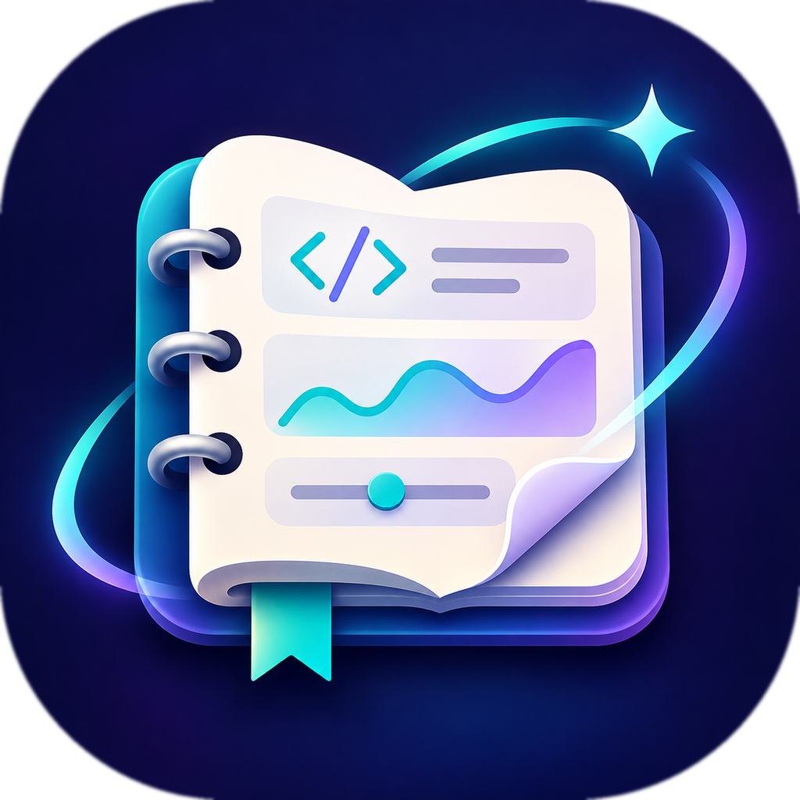

<h1 align="center">
  <br>
  
  <br>
  <b>NotebookPocket</b>
  <br>
</h1>

<p align="center">
  <strong>Write it. Run it. Keep it offline.</strong><br>
  A local-first Android workspace for executable, interactive notebooks.
</p>

<p align="center">
  <a href="https://github.com/KarandaevRuslan/NotebookPocket/actions/workflows/ci.yml"></a>
  
  
  
  
  
</p>

<p align="center">
  <a href="#features">Features</a> ·
  <a href="#getting-started">Build</a> ·
  <a href="ARCHITECTURE.md">Architecture</a> ·
  <a href="docs/RELEASE.md">Releases</a> ·
  <a href="#credits-and-attribution">Credits</a>
</p>

---

## Overview

**NotebookPocket** is an offline-first Android application for creating, editing, running, importing and exporting **Observable Notebooks 2.0**. Notebooks are local HTML documents containing executable reactive cells, Markdown, interactive inputs and attachments. The app uses **Kotlin + Jetpack Compose** for its native interface.

> **Built on two open-source foundations:** [Observable Notebook Kit 2.x](https://github.com/observablehq/notebook-kit) provides the notebook format, compiler and runtime; the source editor is an **adaptation of [Acode](https://github.com/Acode-Foundation/Acode)** powered by CodeMirror 6. NotebookPocket is an independent project and is not an official Observable or Acode product.

No account, hosted backend or Android `INTERNET` permission is required. Built-in libraries are packaged inside the app. Running imported notebooks executes JavaScript locally; see [Security](SECURITY.md) for the limits of this model.

## Features

| Notebook authoring | Local library & storage | Experience |
| --- | --- | --- |
| Source editor based on Acode/CodeMirror | Folders and portable collections | Native Material/Compose UI |
| Observable Notebook Kit live preview | Document and shared collection resources | Portrait and landscape layouts |
| HTML / JavaScript / Markdown notebooks | Import/export of notebook and library archives | Russian and English interface |
| File attachments and Observable Inputs | Optional password protection | Light/dark appearance |
| Bundled Nexus 0.1.20 reactive stores | Encrypted device-local recovery drafts | Clear save states and retry |

**Try the “Pancakes / Блины” sample.** It is an executable recipe, and the bundled Nexus-enhanced edition demonstrates stores, transactions, handlers and Observable interoperation. See [Nexus integration](docs/NEXUS.md) and [`examples/nexus-counter.html`](examples/nexus-counter.html).

<!-- Real screenshots will be added after device verification; avoid placeholder/broken images. -->

## Getting started

**Requirements:** Android Studio or Android SDK Platform 35 with Build Tools 35.0.0, **JDK 17**, **Node.js 22.16+**, Python 3.10+ (for repository checks), and Git. Gradle wrapper and npm lockfile are committed. Put your local Android SDK path in the untracked `local.properties` if needed.

```bash
# 1. Assemble the embedded editor and notebook runtime.
cd web
npm ci
npm run build
cd ..

# 2. Build the Android debug app.
./gradlew :app:assembleDebug
```

Windows PowerShell:

```powershell
cd web
npm ci
npm run build
cd ..
.\gradlew.bat :app:assembleDebug
```

Debug APK: `app/build/outputs/apk/debug/app-debug.apk`. **Build the web assets before Android**: the `verifyWebAssets` task intentionally rejects absent or mismatched embedded bundles. Source JavaScript is committed; generated `app/src/main/assets/web/` bundles are not.

For a one-command PowerShell helper, see `build-apk.ps1`. Detailed troubleshooting is in [docs/BUILDING.md](docs/BUILDING.md).

## Tests and validation

```bash
cd web
npm ci
npm test
npm run test:upstream
npm run build
npm run test:built-preview
cd ..
python3 scripts/check_repository.py
python3 -m unittest discover -s tests -p '*Test.py'
./gradlew :app:testDebugUnitTest :app:lintDebug :app:assembleDebug
```

GitHub Actions runs web and Android checks. Emulator regressions are part of the **tagged draft-release gate**; direct device checks remain necessary for IME, layout/insets, accessibility and WebView behavior. Passing source checks is not proof that a particular device is regression-free.

## Repository map

```text
app/                     Kotlin/Compose Android app, database, secure storage and WebView hosts
web/src/editor/          Acode/CodeMirror integration and editor host
web/src/preview/         Observable Notebook Kit runtime and Nexus bridge
web/vendor/              Pinned offline Nexus npm tarball
third_party/             Third-party source provenance, copyright and license notices
examples/                Importable notebooks
app/src/main/assets/demo/ Built-in sample and migrations
docs/                    Architecture, security, build and release documentation
.github/workflows/       CI, emulator tests and guarded signed draft releases
```

See [ARCHITECTURE.md](ARCHITECTURE.md) for data flows, trust boundaries and saving semantics.

## Release & contributing

The source currently reports **NotebookPocket 0.9.3** (`versionCode` 41). **Nexus 0.1.20 is the bundled library version**, not the Android app version. Releases are prepared as **drafts** after tests and signing; no downloadable public APK is implied by this README. Follow [docs/RELEASE.md](docs/RELEASE.md) and [docs/PUBLISHING.md](docs/PUBLISHING.md).

Contributions and reproducible bug reports are welcome. Read [CONTRIBUTING.md](CONTRIBUTING.md). Never upload private notebooks or signing keys.

## Credits and attribution

NotebookPocket builds on and adapts the work of these projects:

- **[Observable Notebook Kit](https://github.com/observablehq/notebook-kit)** — notebook parser/compiler/runtime and Notebooks 2.0 HTML model (upstream ISC license).
- **[Acode](https://github.com/Acode-Foundation/Acode)** — source editor foundation; adapted Acode editor components, with upstream MIT license and provenance preserved in [`third_party/acode`](third_party/acode).
- **[CodeMirror 6](https://codemirror.net/)** — underlying code editor engine.
- **[Nexus Core 0.1.20](docs/NEXUS.md)** — packaged local npm dependency, transactional state/event integration; see local package provenance and license in `third_party/nexus/`.
- **AndroidX, Kotlin, Vite, Observable Inputs** and their upstream contributors.

**NotebookPocket's own code** is published under [MIT](LICENSE.md); bundled third-party components remain under their **respective** licenses. See [THIRD_PARTY_NOTICES.md](THIRD_PARTY_NOTICES.md). The app icon is original artwork prepared for NotebookPocket.

---

<p align="center"><sub>Independent open-source project • <a href="https://github.com/KarandaevRuslan">@KarandaevRuslan</a></sub></p>
