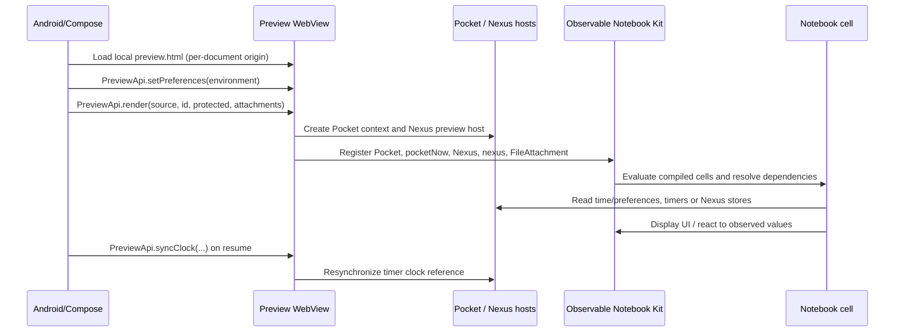

# Notebook authoring and host APIs

This is the API exposed by **NotebookPocket 0.9.3** to executable notebook cells, plus the native resource contract that backs it. It is an application-integration reference, **not** documentation for all of Observable Notebook Kit or [Nexus Core](https://github.com/KarandaevRuslan/Nexus).

> **Quick distinction:** notebook cells can call `Pocket`, `pocketNow`, `FileAttachment`, `Nexus` and `nexus`. `PreviewApi` and `NativeEditor` are *internal application entry points*, not public notebook privileges. The preview WebView has no Android `JavascriptInterface`.

## 1. How the APIs reach a notebook



The JavaScript host is implemented in [`web/src/preview/notebookRuntime.js`](../web/src/preview/notebookRuntime.js), [`web/src/pocket-context.js`](../web/src/pocket-context.js) and [`web/src/preview/nexusRuntime.js`](../web/src/preview/nexusRuntime.js). Android passes preferences and attachments in [`NotebookPreviewWebView.kt`](../app/src/main/java/dev/pocket/notebook/web/NotebookPreviewWebView.kt).

## 2. `Pocket`: app settings, clock and timers

The runtime injects a **read-only `Pocket` context for the current rendering**. It does not provide a way to modify Android settings. Settings are resolved on the Android side, then provided as a JSON payload when the preview renders.

| API | Type | Meaning and source |
| --- | --- | --- |
| `Pocket.theme` | `"light" \| "dark"` | Resolved app appearance, passed as Android's `dark` flag. |
| `Pocket.dark` | `boolean` | Resolved dark-mode state. |
| `Pocket.language` | `"en" \| "ru"` | App UI language resolved by Android; unsupported values fall back to English. |
| `Pocket.locale` | `string` | Android `Locale.forLanguageTag(language).toLanguageTag()`, validated for `Intl` use. |
| `Pocket.timeZone` | `string` | Android device's default time-zone ID (`TimeZone.getDefault().id`), validated for `Intl`. |
| `Pocket.hourCycle` | `"h12" \| "h23"` | Android 12-hour / 24-hour preference (`DateFormat.is24HourFormat`). |
| `Pocket.now()` | `Date` | The current wall-clock date/time, returned on demand. |
| `Pocket.timestamp()` | `number` | Current Unix epoch time in milliseconds (`Date.now()` equivalent). |
| `Pocket.elapsedRealtime()` | `number` | Approximate milliseconds elapsed since the device boot, derived from the last native clock sample and JS monotonic time. Not a wall-clock timestamp. |
| `Pocket.timer(id, initialDurationMs?)` | Timer object | A named countdown timer scoped to the current notebook state key. Default duration: `60000` ms. |
| `pocketNow` | reactive `Date` | Observable value recomputed about **once per second**, suitable for a live clock. |

The `Pocket` values are a snapshot of the configured environment **for that render**. If preferences change, Android requests a render with updated values. In contrast, `pocketNow` is an Observable generator and updates continuously while active.

### Clock example

In an HTML notebook's `type="module"` cell:

```js
const formatter = new Intl.DateTimeFormat(Pocket.locale, {
  dateStyle: 'medium',
  timeStyle: 'medium',
  timeZone: Pocket.timeZone,
  hourCycle: Pocket.hourCycle
});
display(html`<p>Theme: ${Pocket.theme} / Language: ${Pocket.language}</p>`);
display(html`<time>${formatter.format(pocketNow)}</time>`);
```

`Pocket.now()` returns a new value **only when you call it**; use `pocketNow` for reactive updates.

### Where the time comes from

Android sends `System.currentTimeMillis()`, `SystemClock.elapsedRealtime()` and, where available, `Settings.Global.BOOT_COUNT` to the preview when the document is rendered. It sends a fresh sample when the active preview resumes. `createPocketHost` combines that sample with JavaScript's monotonic `performance.now()` to track timers despite changes to the wall clock. Persisted timers additionally record a wall-clock deadline for reboot/fallback recovery. The wall clock and time-zone preference still ultimately come from the **device**, not a remote service; no network/time API is called.

### Timer API

```js
const timer = Pocket.timer('study-session', 5 * 60_000);
timer.start();
const state = timer.snapshot();
display(html`<p>${Math.ceil(state.remainingMs / 1000)} seconds left</p>`);
// timer.pause();
// timer.reset();           // reset to its current duration
// timer.reset(90_000);     // replace the duration
```

| Method / snapshot field | Meaning |
| --- | --- |
| `start()` / `pause()` / `reset(durationMs?)` | Change timer state; each returns the current snapshot. |
| `snapshot()` | Current frozen object with `durationMs`, `remainingMs`, `elapsedMs`, `running`, `finished`. |
| `id` | Must match `^[\\w.-]{1,80}$`; IDs are unique within the current document state key. |
| Duration | Between **1 ms and 7 days**; at most **64 timers** in one scope. |

`snapshot()` does **not** trigger Observable recomputation by itself. Use a separate clock (`pocketNow`), interval, or other reactive dependency if the UI must update while a countdown runs. The built-in Pancakes example refreshes its timer on an interval.

For **unprotected notebooks**, timer state is saved in that notebook's `localStorage` namespace (including `data-state-version` when present). **Password-protected** previews disable DOM storage and keep timer values in memory only; reopening resets them. Preview Reset clears active notebook timers and form state without editing its HTML source.

## 3. Nexus Core and the NotebookPocket bridge

**Source:** [`web/src/preview/nexusRuntime.js`](../web/src/preview/nexusRuntime.js). The code imports `core` from **`nexus/core`** and injects two distinct objects into Observable runtime:

| Name | API | Lifetime / behavior |
| --- | --- | --- |
| `Nexus` | Frozen collection of upstream `nexus/core` exports, including `Dispatcher`, `Handler`, `Scope`, `Store`, `Event` | Library API; application does not replace these classes. |
| `nexus.version` | `"0.1.20"` | Version of the bundled local package. |
| `nexus.dispatcher` | One `Nexus.Dispatcher` instance | Shared within **one preview render**, not across documents. |
| `nexus.scope(invalidation?)` | Returns managed `Nexus.Scope` | Disposed automatically after the supplied Observable `invalidation` Promise resolves, or when the preview ends. Without a Promise, lives until preview disposal or explicit `dispose()`. |
| `nexus.observe(scope, store)` | Observable-compatible generator | Emits the current Store value and future committed updates. Requires an active scope returned by `nexus.scope()` and a Store owned by the current preview dispatcher. |

`scope.store`, `scope.register`, `scope.cleanup`, `scope.guard`, `scope.submit` and `scope.submitAndWait` belong to the **Nexus Core Scope**; they are not additional methods invented by NotebookPocket. Refer to [the Nexus project](https://github.com/KarandaevRuslan/Nexus) for full Core behavior.

### Create a store, commit updates and clean up

```js
const scope = nexus.scope(invalidation);
const count = scope.store(0);
const button = html`<button type="button">Increment</button>`;
const click = scope.guard(() => {
  nexus.dispatcher.inline(ctx => {
    ctx.set(count, ctx.read(count) + 1);
  });
});
button.addEventListener('click', click);
scope.cleanup(() => button.removeEventListener('click', click));
display(button);
```

### Derive state with a Handler

```js
const doubled = scope.store(0);
class UpdateDouble extends Nexus.Handler {
  run(ctx) { ctx.set(doubled, ctx.read(count) * 2); }
}
scope.register(new UpdateDouble(), {
  on: { any: [count] }, initial: true, execution: 'inline'
});
```

### Feed Nexus changes into Observable

Use an **OJS cell** (not a regular JavaScript variable holding a generator):

```html
<script id="4" type="application/vnd.observable.javascript">
doubledValue = nexus.observe(scope, doubled)
</script>
```

In another `type="module"` cell, `doubledValue` is reactive and can be displayed:

```js
display(html`<output>${doubledValue}</output>`);
```

`nexus.observe(...)` uses an Observable generator; the bridge may coalesce rapid intermediate updates. For *every* transition use a Nexus Handler. The bridge refuses a foreign Store or a scope that does not belong to the active preview.

**Lifecycle:** every new notebook render creates a new dispatcher, releases managed scopes on cell invalidation and preview teardown, then disposes the Observable runtime. Nexus state is **memory-only** in this integration and is not saved to Room, draft files or `localStorage`. Directly constructed upstream Nexus objects require the author to manage their own cleanup. Frida-specific Nexus adapters are not part of this browser runtime.

Walk-throughs: [Nexus integration guide](NEXUS.md), [importable counter example](../examples/nexus-counter.html), [Pancakes sample](../app/src/main/assets/demo/pancakes/notebook.html).

## 4. Notebook and collection attachments: `FileAttachment`

Notebook Kit exposes `FileAttachment(name)`. NotebookPocket supplies a **document-scoped URL resolver**; it does *not* expose arbitrary filesystem paths or the entire Android repository.

```js
const pictureUrl = await FileAttachment('images/cover.png').url();
const noteText = await FileAttachment('notes/instructions.md').text();
const options = await FileAttachment('config/options.json').json();
// Only when this notebook belongs to a collection with that resource:
const sharedText = await FileAttachment('shared/common/tips.txt').text();
```

| Resource owner | Browser reference | Where data is stored |
| --- | --- | --- |
| Current notebook | `FileAttachment('images/cover.png')` | Files inside its document package. |
| Its containing collection | `FileAttachment('shared/common/tips.txt')` | Files in the parent collection's shared resource set. |

The Resources tab supports files/directories, text editing and copy/move operations; the **Shared collection** choice is available when the document has an applicable parent collection. Paths are relative; never use absolute paths, backslashes, colons, empty `.`/`..` segments or control characters. Native storage validates file paths and package limits; `FileAttachment` can read **only registered paths** passed for the current notebook.

Android supplies the allowlisted names and a base URL similar to:

```text
https://preview-<document-hash>.notebook.invalid/notebook-resources/<session-scope>/
```

The random scope is created by Android and checked by the resource loader. JavaScript validates the expected origin format and encodes path segments; Android checks scheme, origin and scope, then serves local bytes with a content type. External HTTP(S) is blocked by the WebView client, not fetched as a fallback. Changing the document or scope invalidates the previous URL capability.

`FileAttachment` methods such as `.url()`, `.text()` and `.json()` are **Notebook Kit's file-attachment API**; the notebook-specific filesystem mapping is the NotebookPocket extension. The `ResourcePaths.kt` helper inserts the correct `FileAttachment('shared/...')` reference when copying a shared resource path from the native UI.

### Native resource API (Kotlin, not notebook JavaScript)

The Android-side interface is [`NotebookResourceAccess`](../app/src/main/java/dev/pocket/notebook/domain/NotebookResourceAccess.kt), implemented by `ResourceFacade` → `ResourceAccess` → `NotebookResources`:

| Method group | Signatures / purpose |
| --- | --- |
| Browse | `resourceFiles(owner)`, `resourceEntries(owner, directory)`, `resourceEntry(owner, path)` |
| Read and create | `readResource(owner, path)`, `putResource(owner, path, bytes)`, `createResourceFolder(owner, path)` |
| Update safely | `replaceResource(owner, path, bytes, expectedHash)` rejects concurrent modifications. |
| Rename/delete | `renameResource(owner, path, newPath)`, `deleteResource(s)` |
| Move/copy | `transferResources(source, paths, target, destination, cut)` |
| Security & ownership | `ownerProtected(id)`, `resourceOwner(id)` |
| Preview projection | `attachmentNames(notebookId)`, `attachment(notebookId, path)` |

Here `owner` is a notebook **or collection** ID, depending on the selected resource scope. These synchronous facade calls serialize repository work and **must be invoked off the Android main/UI thread** when they perform I/O. They are not callable from notebook JavaScript.

## 5. Other built-ins and unsupported capabilities

NotebookPocket runs the actual **Observable Notebook Kit 2.x** compiler/runtime. It overrides the library entries for `Inputs`, `html`, `svg` and `htl` with packaged npm modules so routine controls work **offline**, while retaining the other upstream built-ins. Preview-wide Observable Inputs styling is imported by `web/src/preview.js` for every notebook, not just the sample.

The supported cell modes in this host are `js`, `md`, `html`, `ts`, `ojs` and `tex`. The current host **rejects compiled cells with external imports** rather than permitting runtime CDN or arbitrary network fetching. Notebook code still executes arbitrary JavaScript *within its preview*; importing untrusted notebooks is not equivalent to opening an inert document. See [security policy](../SECURITY.md) and [architecture](../ARCHITECTURE.md).

### Internal entry points — not public notebook APIs

- `window.PreviewApi`: owned by trusted preview bootstrap and called through `evaluateJavascript` by Android. Its `setPreferences`, `render`, `syncClock` and `resetState` methods implement the host contract. Notebook authors should use `Pocket`, `pocketNow`, `FileAttachment` and `nexus` instead.
- `window.NativeEditor`: a `@JavascriptInterface` installed **only in the trusted Acode editor WebView** for source edits, selection, native clipboard and keyboard handling. The untrusted preview does **not** receive it.
- A notebook does **not** get direct Room queries, Android file I/O, arbitrary keystore access, network access or a `Nexus`-to-Android bridge.

## 6. Version and compatibility

This document describes the source snapshot **NotebookPocket 0.9.3**, Observable Notebook Kit **2.9.1** and Nexus Core **0.1.20**. The Nexus package is vendored at `web/vendor/nexus-0.1.20.tgz` as a local npm dependency; the installed code is bundled into the APK by Vite. See [provenance](../third_party/nexus/README.md), [architecture](../ARCHITECTURE.md) and [build guide](BUILDING.md).
